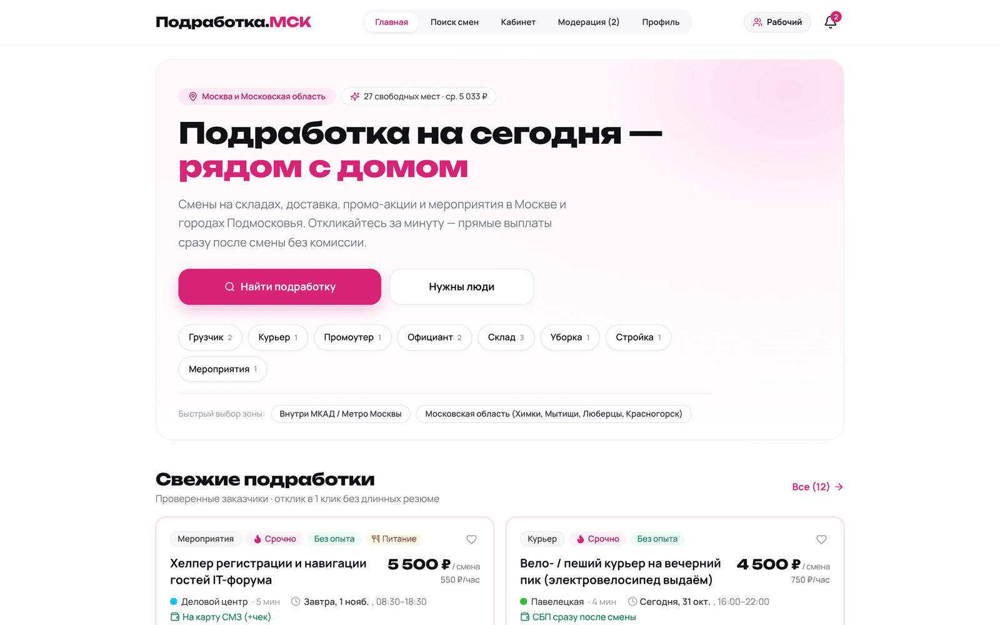
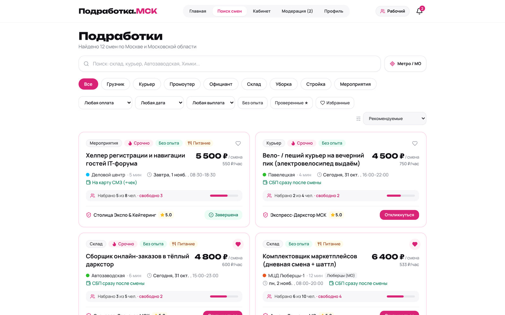
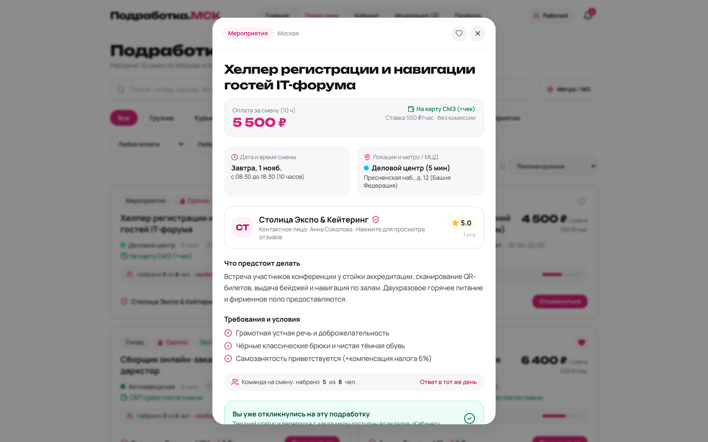
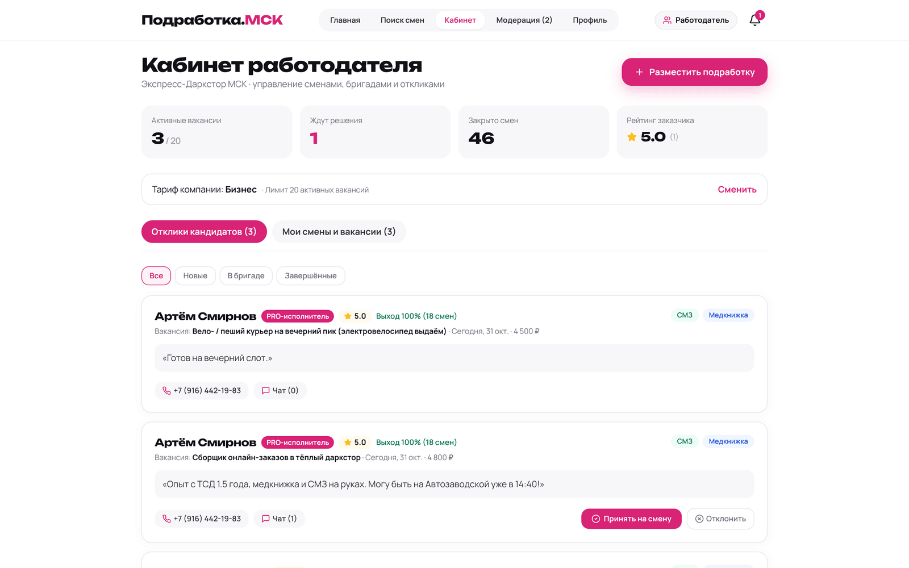
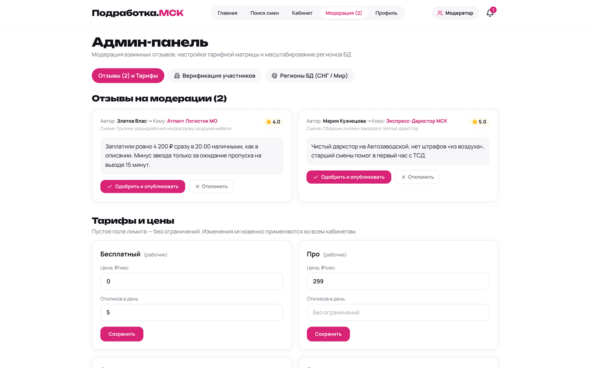
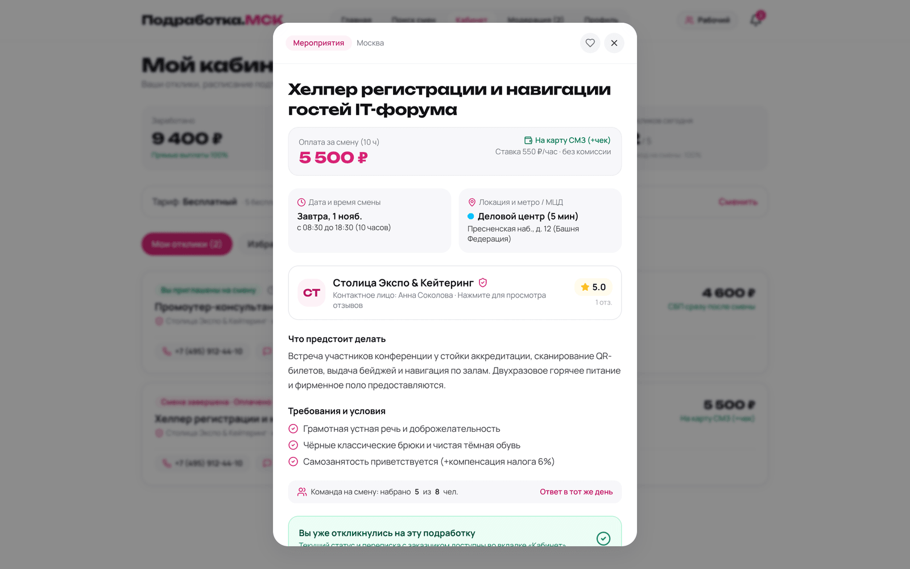
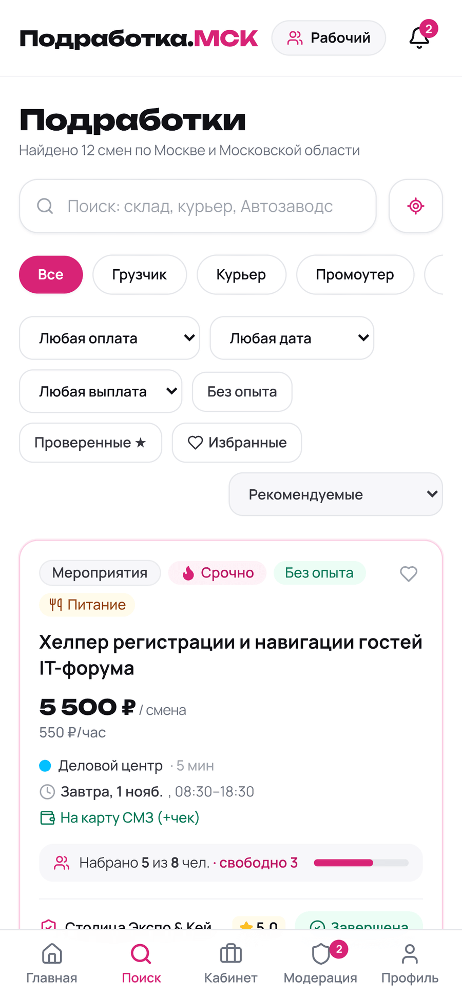

<div align="center">
  
</div>

<h1 align="center">Подработка.МСК</h1>

<p align="center">
  Платформа быстрых смен в Москве и Московской области.<br/>
  Работодатель публикует смену за минуту, исполнитель откликается в один клик и получает деньги сразу после смены — без комиссии с заработка.
</p>

<p align="center">
  <a href="https://visiontripin.github.io/eco/"><b>▶ Открыть демо</b></a> ·
  <a href="#быстрый-старт">Быстрый старт</a> ·
  <a href="#как-это-устроено">Архитектура</a> ·
  <a href="#api">API</a>
</p>

<p align="center">
  <a href="https://github.com/visiontripin/eco/actions/workflows/ci.yml"></a>
  
  
  
</p>

---

## Что это

Продукт закрывает разрыв между «нужен человек на смену сегодня» и «хочу заработать завтра же»:
короткие смены на 4–12 часов в Москве и Подмосковье, прозрачная оплата за смену,
проверенные заказчики и рейтинг, который нельзя купить.

Три роли в одном приложении:

| Роль | Что делает |
|---|---|
| **Рабочий** | Ищет смены по метро/МЦД и датам, откликается, ведёт кабинет заработка, получает оценки |
| **Работодатель** | Публикует смены, собирает бригаду «N из M», ведёт воронку кандидатов, закрывает смены |
| **Модератор** | Проверяет отзывы, выдаёт статус «Проверенный», настраивает тарифы и регионы |

Демо-версия уже наполнена реалистичными данными: 12 смен, 7 пользователей, 4 тарифа,
станции метро и МЦД, отзывы на модерации.

## Скриншоты

| Главная · Рабочий | Поиск смен | Карточка смены |
|---|---|---|
|  |  |  |

| Кабинет работодателя | Админ-панель и модерация | Кабинет рабочего |
|---|---|---|
|  |  |  |

<div align="center">
  
  
  <br/>
  <sub>Мобильная версия: нижняя навигация, крупные тач-зоны, PWA-манифест</sub>
</div>

## Возможности

**Витрина и поиск**
- Полнотекстовый поиск по названию, адресу и станции; фильтры по категории, району (Москва / МО), оплате, датам («Сегодня», «Завтра», «Ближайшие дни») и способу выплаты.
- Станции метро и МЦД с цветом линии и пешей доступностью, сортировка по релевантности и оплате.
- Бейджи «Срочно», «Без опыта», «Питание», «Проверенный ★», «Избранное».

**Рабочему**
- Отклик в один клик с сопроводительной запиской, лимиты по тарифу, история откликов и статусов.
- Кабинет: заработано за закрытые смены, активные смены, честный рейтинг и индекс выходов (show-up rate), избранное, мини-чат с работодателем, взаимные оценки.
- Профиль: медицина, самозанятость, готовность к ночным сменам, навыки, город и станция.

**Работодателю**
- Публикация смены с автоматическим расчётом часовой ставки, командный набор «N из M», клонирование смены на завтра, пауза и возобновление.
- Воронка кандидатов с приоритетом PRO-исполнителей, принятие и отклонение, закрытие смены и оценка работников.
- Тарифы с реальными лимитами: Бесплатный, Про 299 ₽, Старт, Бизнес 1 990 ₽.

**Модератору**
- Живая очередь отзывов с мгновенным пересчётом рейтингов, верификация участников, редактирование тарифов и лимитов.
- Регионы международного масштабирования (RU, BY, KZ, UZ, AE) с валютами, часовыми поясами и локалями — в SQLite-схеме с первого дня.

## Как это устроено

```
┌─────────────────────────────────────────────────────────────────────┐
│  Браузер                                                             │
│  React 18 + TypeScript + Tailwind CSS + lucide-react                 │
│  один и тот же UI-код                                                │
└───────────────┬─────────────────────────────────────────────────────┘
                │  src/lib/api.ts — единая точка доступа к данным
                │  (fetch → /api/*, 3-секундный таймаут, фолбэк)
      ┌─────────┴──────────┐
      │                    │
┌─────▼──────────────┐  ┌──▼──────────────────────────────────────────┐
│  Server (Node 22)  │  │  Offline-движок src/lib/browserDb.ts        │
│  Express + node:   │  │  те же эндпоинты, данные в localStorage     │
│  sqlite (SQLite)   │  │  включается на github.io / file:// / при    │
│  Vite middleware в │  │  недоступном API — демо живёт без сервера   │
│  dev, dist/ в prod │  └─────────────────────────────────────────────┘
└────────────────────┘
```

- **Один код — два режима.** `npm run dev` поднимает full-stack (API + SQLite + HMR). `npm run build:static` собирает автономный одностраничный HTML, который работает без бэкенда: так демо живёт на GitHub Pages и открывается с телефона офлайн.
- **Данные.** SQLite через встроенный модуль `node:sqlite` (без нативных зависимостей и без Docker для БД): 10 таблиц, сиды при первом запуске, WAL-режим.
- **Типы насквозь.** `tsc --noEmit` в strict-режиме проверяет и фронтенд, и сервер.
- **Ноль внешних ассетов.** Шрифты Manrope и Unbounded (OFL) лежат в `src/assets/fonts` — приложение не делает запросов к Google Fonts и корректно рендерится офлайн.

### Модель данных

```
users ──┬── jobs ──┬── applications ── messages
        │          └── favorites
        ├── reviews        (взаимные оценки, модерация)
        ├── notifications
        └── tariffs        (лимиты по роли)

regions ── locations      (ISO-коды, валюта, таймзона, локаль; метро / МЦД / города МО)
```

## Быстрый старт

```bash
git clone https://github.com/visiontripin/eco.git
cd eco
npm install
npm run dev
```

Приложение и API — на одном порту: **http://localhost:3000**.
База создаётся автоматически в `data/podrabotka.sqlite` и наполняется демо-данными.

| Команда | Что делает |
|---|---|
| `npm run dev` | Full-stack в режиме разработки (Express + Vite HMR) |
| `npm run build` | Проверка типов + production-сборка фронтенда в `dist/` |
| `npm start` | Production-сервер: API + раздача `dist/` на `PORT` (по умолчанию 3000) |
| `npm run build:static` | Автономная версия в `docs/` (GitHub Pages) + Android-архив |
| `npm run verify` | Всё сразу: типы, сборка, статическая сборка |

Переменные окружения — см. [`.env.example`](.env.example) (`PORT`, `NODE_ENV`, `DATA_DIR`, `DB_PATH`).

## Демо-аккаунты

Авторизация в демо упрощена: клиент присылает заголовок `X-User-Id`, а роль переключается
кнопкой в правом верхнем углу. Никаких паролей и внешних сервисов.

| ID | Имя | Роль | Что посмотреть |
|---|---|---|---|
| 1 | Златов Влас | Рабочий | Отклики, заработок, рейтинг |
| 2 | Илья Громов | Работодатель | Воронка кандидатов, публикация смены |
| 7 | Алексей Морозов | Модератор | Очередь отзывов, тарифы, регионы |

## Запуск и деплой

### GitHub Pages (демо без сервера)

`npm run build:static` собирает `docs/` — коммит в `main` публикует его автоматически:

- **https://visiontripin.github.io/eco/** — приложение (движок `browserDb`, данные в браузере);
- `/downloads/podrabotka-msk-android-preview.zip` — автономный архив для Android (открывается без интернета).

Сборка лежит в репозитории намеренно: сайт остаётся доступен даже без CI и без сервера.

### Docker (full-stack с API и SQLite)

```bash
docker build -t podrabotka-msk .
docker run -p 3000:3000 -v "$PWD/data:/app/data" podrabotka-msk
```

Образ содержит `HEALTHCHECK` на `/api/health`; базу монтируйте томом, чтобы данные переживали перезапуск.

### Проверка живости

```bash
curl -s localhost:3000/api/health
# {"status":"ok","service":"podrabotka-msk","uptime_seconds":3,"jobs_count":12}
```

## API

Все эндпоинты отдают JSON и принимают `X-User-Id` (демо-аутентификация).

| Метод | Путь | Назначение |
|---|---|---|
| `GET` | `/api/bootstrap` | Профиль, тарифы, локации, статистика, уведомления |
| `GET` | `/api/jobs` | Каталог смен (фильтры: `employer_id`, `include_inactive`, поиск, категории) |
| `POST` | `/api/jobs` | Публикация смены с проверкой лимита тарифа |
| `PATCH` | `/api/jobs/:id` | Пауза, возобновление, закрытие смены |
| `POST` | `/api/jobs/:id/clone` | Клонирование смены на завтра |
| `POST` | `/api/jobs/:id/apply` | Отклик на смену (учитывает дневной лимит) |
| `POST` | `/api/jobs/:id/favorite` | Избранное |
| `GET` | `/api/applications` | Отклики по роли |
| `PATCH` | `/api/applications/:id/status` | Принять / отклонить / закрыть смену |
| `POST` | `/api/applications/:id/messages` | Сообщение в мини-чат |
| `POST` | `/api/reviews` | Оценка контрагента после смены |
| `PUT` | `/api/me/profile` | Обновление профиля |
| `PUT` | `/api/me/tariff` | Смена тарифа |
| `POST` | `/api/auth/login` · `/api/auth/register` | Демо-вход и регистрация |
| `GET` | `/api/admin/overview` | Сводка модерации |
| `PATCH` | `/api/admin/reviews/:id` | Одобрить / отклонить отзыв |
| `PUT` | `/api/admin/tariffs/:id` | Цена и лимиты тарифа |
| `PATCH` | `/api/admin/users/:id/verify` | Статус «Проверенный» |
| `PATCH` | `/api/admin/regions/:id` | Включить регион масштабирования |
| `GET` | `/api/health` | Healthcheck для деплоя |

## Структура репозитория

```
.
├── src/                  # React-приложение
│   ├── views/            # Главная, поиск, кабинеты, админка, профиль
│   ├── components/       # Карточки смен, модальные окна, формы
│   ├── lib/              # api.ts (транспорт + фолбэк), browserDb.ts (offline-движок)
│   ├── assets/fonts/     # Manrope + Unbounded (OFL), локально
│   └── styles/fonts.css
├── server/               # Express API, схема и сиды SQLite
├── scripts/build-static.mjs   # автономная сборка для GitHub Pages
├── screenshots/          # реальные скриншоты интерфейса
├── docs/                 # сгенерированный сайт для GitHub Pages (не править руками)
├── archive/tws-hub/      # архивный инженерный проект (не часть продукта)
└── .github/workflows/    # CI: типы, сборка, smoke-тест API
```

## Проверки

```bash
npm run verify   # typecheck + сборка + автономная сборка
npm start & curl -fsS localhost:3000/api/health
```

CI на каждый push в `main` и на pull request выполняет те же шаги плюс smoke-тест `/api/health`
и публикует артефакт статической сборки.

## Ограничения

Это работающий MVP с демо-данными, а не продакшен-маркетплейс:

- **Аутентификация демонстрационная** — идентификатор пользователя приходит заголовком, сессий и паролей нет.
- **Платежи и выплаты не подключены** — «СБП сразу», «На руки», «СМЗ» отражены в модели данных и UI, но не проводятся.
- **SQLite подходит для одного инстанса**; для горизонтального масштабирования нужен PostgreSQL.
- **Уведомления и чат** работают в рамках приложения, без push и внешних каналов.
- Тексты вакансий и отзывы — сгенерированные демо-данные, реальные компании и люди не упоминаются.

## Дорожная карта

- [ ] Реальная аутентификация (SMS-код по телефону) и сессии
- [ ] PostgreSQL + миграции, вынос API в отдельный сервис
- [ ] Выплаты через СБП и интеграция с самозанятостью (СМЗ)
- [ ] Push-уведомления и realtime-чат
- [ ] Админ-аналитика: конверсия откликов, стоимость смены, отток
- [ ] Городские запуски через `regions` / `locations` (СПб, Минск, Алматы)

## Благодарности и лицензия

Код — [MIT](LICENSE). Шрифты Manrope и Unbounded — SIL Open Font License, тексты лицензий
лежат в `src/assets/fonts/`. Иконки — [lucide](https://lucide.dev) (ISC).

Архивный проект в `archive/tws-hub/` относится к другому продукту (Bluetooth-хаб для колонок)
и сохранён как инженерная документация, в сборку не входит.
